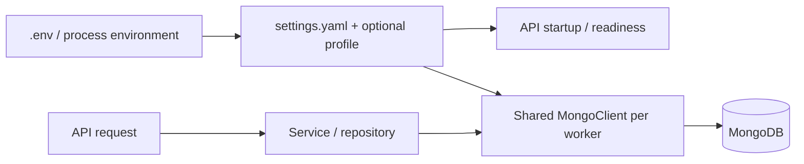

# API configuration and MongoDB lifecycle

This repository provides repositories and configuration for a consuming API. It
does not currently include an HTTP server or routes.

Configuration is loaded once at import. Existing process variables take precedence
over `.env`. The loader searches the working directory and its ancestors for
`settings.yaml` or `resources/settings.yaml`, also accepting `.yml`. `PROJECT_ROOT`
selects an explicit application root. Within each directory, `.yaml` wins over
`.yml`. An optional `settings-<profile>.yaml` (or `.yml`) recursively overrides
master values. Lists are replaced. An explicitly configured but missing database
setting fails startup. Arbitrary API settings can live in the same file and are
available through `value("app.name")` or `value("${app.name:default}")`.

Environment values are interpolated after parsing YAML so quotes, colons and
newlines in credentials cannot create additional configuration keys. A complete
placeholder containing an integer or boolean is converted to that scalar type.
The URI comes from `mongodb.uri`, falling back to `mongoURI` then `MONGO_URI`.
The database is explicit to avoid accidentally selecting an authentication DB.

The API should call `ping_mongo()` at startup or on a readiness request. A client
constructor alone does not prove the server is reachable. Construct one shared
client lazily per worker and let PyMongo manage sockets, monitoring and recovery.
Do not close it after individual requests. The configured timeouts bound server
selection, socket use, pool waits and operation duration. Tune them for the API's
request budget and query workload; the sample values are starting points.

When connectivity drops, in-flight requests can fail. The same client can serve
later requests after MongoDB recovers. PyMongo retries eligible reads and writes
according to driver/server support; this is not a guarantee that every operation
succeeds. Application retries of arbitrary writes can duplicate effects and are
not added here. A consuming HTTP API should catch connection/timeout errors at
its boundary, return a generic unavailable response (typically 503), and avoid
returning driver error details or credentials to callers. Readiness should fail
while the DB is unreachable; liveness should reflect the API process itself.

At shutdown, drain active requests and call `close_db_connection()`. Closing is
idempotent and clears the cached client. A later newly created repository gets a
fresh client. Existing repositories hold collection handles tied to the old
client and must be recreated after explicit shutdown. Closing is not used as a
recovery mechanism during an outage.

There is no custom background reconnect thread or blanket retry loop: PyMongo
already owns topology monitoring and connection replacement. A network outage
differs from explicitly closing a client, which makes that client unusable.
